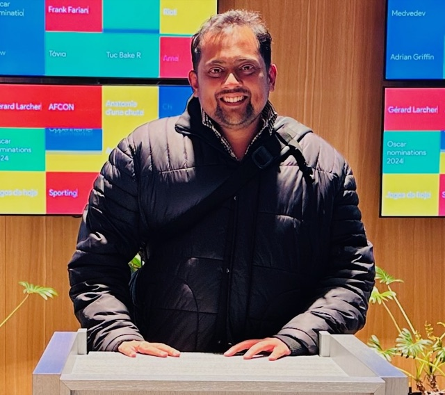

```{=html}
<header class="topbar">
  <a class="brand" href="#top"><span class="brand-mark">RP</span> Rakesh Poduval</a>
  <nav>
    <a href="#about">About</a>
    <a href="#services">Work with me</a>
    <a href="#expertise">Expertise</a>
    <a href="#experience">Experience</a>
    <a href="#projects">Projects</a>
    <a href="#credentials">Credentials</a>
    <a class="btn-nav" href="#contact">Get in touch</a>
    <button class="mode-toggle" type="button" aria-label="Switch between light and dark mode" onclick="var d=document.documentElement,m=d.dataset.mode==='dark'?'light':'dark';d.dataset.mode=m;try{localStorage.setItem('mode',m)}catch(e){}"><i class="bi bi-moon-stars-fill"></i><i class="bi bi-sun-fill"></i></button>
  </nav>
</header>

<main id="top">

<section class="hero">
  <div class="wrap hero-grid">
    <div class="hero-text">
      <span class="pill"><i class="bi bi-geo-alt-fill"></i> Palakkad, Kerala &middot; Available worldwide, remotely</span>
      <h1>Hi, I'm <span class="grad">Rakesh Poduval</span></h1>
      <p class="role">Data Science Leader &amp; Statistician</p>
      <p class="lead">I turn messy data into decisions. 16+ years across India and Switzerland, leading a team of 10+ data scientists, and now helping more teams with <strong>consulting, training and workshops</strong> in Statistics, R, Machine Learning and GenAI.</p>
      <div class="cta">
        <a class="btn primary" href="mailto:poduval.rakesh@icloud.com"><i class="bi bi-envelope-fill"></i> poduval.rakesh@icloud.com</a>
        <a class="btn ghost" href="https://www.linkedin.com/in/poduvalrakesh/" target="_blank" rel="noopener"><i class="bi bi-linkedin"></i> LinkedIn</a>
        <a class="btn ghost" href="https://github.com/Poduval" target="_blank" rel="noopener"><i class="bi bi-github"></i> GitHub</a>
      </div>
    </div>
    <div class="hero-photo">
      <div class="photo-ring"></div>
    </div>
  </div>
</section>

<section class="stats">
  <div class="wrap stats-grid">
    <div class="stat"><b>16+</b><span>years in data science &amp; statistics</span></div>
    <div class="stat"><b>10+</b><span>data scientists led</span></div>
    <div class="stat"><b>2010</b><span>building Swiss real-estate valuation models</span></div>
    <div class="stat"><b>2 yrs</b><span>on-site in Zurich, Switzerland</span></div>
  </div>
</section>

<section id="about" class="section">
  <div class="wrap two">
    <div>
      <p class="eyebrow">About</p>
      <h2>Most data problems aren't model problems.</h2>
      <p class="quote">They're statistics, clarity and trust problems.</p>
    </div>
    <div class="prose">
      <p>I'm a statistician turned data science leader. Today I lead a team building <strong>Automated Valuation Models (AVMs)</strong> for Swiss real-estate finance, a regulated, business-critical setting where models have to be accurate <em>and</em> explainable.</p>
      <p>My strengths are statistics at depth (M.Sc. Statistics, mixed and hierarchical models at ETH Zurich), production R (internal packages served as REST APIs, Shiny apps, automated reports) and a growing practice in GenAI and AI agents. I also run workshops and talks at universities across Kerala.</p>
      <p class="langs"><i class="bi bi-translate"></i> English &middot; Hindi &middot; Bengali &middot; Malayalam</p>
    </div>
  </div>
</section>

<section id="services" class="section alt">
  <div class="wrap">
    <p class="eyebrow">Work with me</p>
    <h2>How I can help</h2>
    <div class="cards three">
      <article class="card">
        <div class="icon"><i class="bi bi-lightbulb-fill"></i></div>
        <h3>Consulting</h3>
        <p>Stuck on a data or business challenge? Sometimes you just need someone who has seen it before. Forecasting, pricing, modelling and GenAI, with honest, practical advice.</p>
      </article>
      <article class="card">
        <div class="icon"><i class="bi bi-mortarboard-fill"></i></div>
        <h3>Training &amp; workshops</h3>
        <p>Hands-on sessions in Statistics, R Programming, Machine Learning, and GenAI and AI Agents, plus Data Literacy for managers. For institutions, teams and freshers. Online or in person in Kerala, from one day to multi-week programmes.</p>
      </article>
      <article class="card">
        <div class="icon"><i class="bi bi-megaphone-fill"></i></div>
        <h3>Talks</h3>
        <p>Conferences, institutions and events. Practical statistics, honest GenAI lessons and what it takes to lead data teams.</p>
      </article>
    </div>
  </div>
</section>

<section id="expertise" class="section">
  <div class="wrap">
    <p class="eyebrow">Expertise</p>
    <h2>What I bring</h2>
    <div class="cards four">
      <article class="card slim"><div class="icon sm"><i class="bi bi-bar-chart-line-fill"></i></div><h3>Statistics</h3>
        <div class="tags"><span>Hedonic regression</span><span>Mixed models</span><span>Time series</span><span>Model validation</span><span>Backtesting</span></div></article>
      <article class="card slim"><div class="icon sm"><i class="bi bi-cpu-fill"></i></div><h3>Machine learning</h3>
        <div class="tags"><span>Predictive modelling</span><span>Valuation (AVM)</span><span>Text mining</span><span>MLOps</span></div></article>
      <article class="card slim"><div class="icon sm"><i class="bi bi-robot"></i></div><h3>GenAI &amp; agents</h3>
        <div class="tags"><span>LLM APIs</span><span>RAG</span><span>LangChain</span><span>LangGraph</span><span>CrewAI</span><span>LlamaIndex</span><span>MCP</span></div></article>
      <article class="card slim"><div class="icon sm"><i class="bi bi-boxes"></i></div><h3>Engineering</h3>
        <div class="tags"><span>R packages &amp; Shiny</span><span>Python</span><span>SQL</span><span>Docker</span><span>Kubernetes</span><span>Airflow</span><span>CI/CD</span></div></article>
    </div>
  </div>
</section>

<section id="experience" class="section alt">
  <div class="wrap">
    <p class="eyebrow">Experience</p>
    <h2>Career timeline</h2>
    <ol class="timeline">
      <li>
        <span class="when">Apr 2026 &ndash; Present</span>
        <h3>Senior Project Manager, Data Science &amp; AI</h3>
        <p class="org">IMMO Information Technology &middot; Swiss real-estate finance (IAZI AG / CIFI SA)</p>
        <p>Own delivery of data and AI products end to end, from a blank page to a shipped product. Lead a 10+ member team, own the core R products and AVMs through deployment, and build the team's first AI agents with Microsoft Agent Framework and MCP tools.</p>
      </li>
      <li>
        <span class="when">Jul 2019 &ndash; Mar 2026</span>
        <h3>Project Manager</h3>
        <p class="org">IMMO Information Technology</p>
        <p>Grew the data science team to 10+, developed AVMs and owned the legacy hedonic models through validation and production. Helped launch the model backtesting report, a client product supporting banks' internal model validation.</p>
      </li>
      <li>
        <span class="when">Jul 2017 &ndash; Jul 2019</span>
        <h3>Senior Consultant &amp; Team Lead, Zurich</h3>
        <p class="org">IAZI AG / CIFI SA &middot; on-site in Switzerland</p>
        <p>Built hedonic and ML models embedded in flagship AVM products, hardened R for production and led the India-based team supporting Swiss operations.</p>
      </li>
      <li>
        <span class="when">Sep 2016 &ndash; May 2017</span>
        <h3>Assistant Manager</h3>
        <p class="org">Genpact &middot; Bengaluru</p>
        <p>Retail and CPG analytics: assortment, pricing and promotion analytics for global FMCG clients using SQL and R.</p>
      </li>
      <li>
        <span class="when">Sep 2010 &ndash; Aug 2016</span>
        <h3>Junior Statistician to Senior Statistician</h3>
        <p class="org">IMMO Information Technology &middot; Panaji, Goa</p>
        <p>Where the journey began: regression-based valuation models and data pipelines on Swiss property data with R and SQL.</p>
      </li>
      <li>
        <span class="when">Oct 2011 &ndash; Dec 2012</span>
        <h3>Data Analyst</h3>
        <p class="org">Arbitron India (now Nielsen Audio) &middot; Kochi</p>
        <p>Media audience measurement and market-research analytics with SPSS.</p>
      </li>
    </ol>
  </div>
</section>

<section id="projects" class="section">
  <div class="wrap">
    <p class="eyebrow">Projects</p>
    <h2>Things I've built</h2>
    <div class="cards three">
      <a class="card link" href="https://poduval.shinyapps.io/resquisse/" target="_blank" rel="noopener">
        <div class="icon"><i class="bi bi-bar-chart-steps"></i></div>
        <h3>resquisse <i class="bi bi-box-arrow-up-right"></i></h3>
        <p>A free R Shiny chart builder. Drag and drop to build charts, no R install needed.</p>
        <div class="tags"><span>R</span><span>Shiny</span><span>Data viz</span></div>
      </a>
      <article class="card">
        <div class="icon"><i class="bi bi-diagram-3-fill"></i></div>
        <h3>Multi-agent AI ecosystem</h3>
        <p>Collaborating agents using LangGraph and CrewAI with planning, reasoning and tool use to solve compound tasks.</p>
        <div class="tags"><span>GenAI</span><span>Agents</span></div>
      </article>
      <article class="card">
        <div class="icon"><i class="bi bi-chat-square-text-fill"></i></div>
        <h3>Product insight generator</h3>
        <p>A prompt-chained summariser that turns raw customer reviews into structured pros and cons.</p>
        <div class="tags"><span>GenAI</span><span>NLP</span></div>
      </article>
    </div>
    <p class="more"><a href="https://github.com/Poduval" target="_blank" rel="noopener"><i class="bi bi-github"></i> More R packages, Shiny apps and code samples on GitHub <i class="bi bi-arrow-right"></i></a></p>
  </div>
</section>

<section id="credentials" class="section alt">
  <div class="wrap two">
    <div>
      <p class="eyebrow">Education</p>
      <h2>Foundations</h2>
      <ul class="ticks">
        <li><i class="bi bi-mortarboard"></i><div><b>M.Sc. Statistics</b><span>CUSAT, 2008&ndash;2010</span></div></li>
        <li><i class="bi bi-mortarboard"></i><div><b>B.Sc. Statistics</b><span>St. Thomas' College, Thrissur, 2005&ndash;2008</span></div></li>
        <li><i class="bi bi-journal-text"></i><div><b>Published research</b><span>Kernel-based Estimation of Ageing Intensity Function: Properties and Applications</span></div></li>
      </ul>
    </div>
    <div>
      <p class="eyebrow">Certifications</p>
      <h2>Always learning</h2>
      <ul class="ticks">
        <li><i class="bi bi-patch-check-fill"></i><div><b>Advanced Certification in GenAI &amp; Multi-Agent Systems</b><span>Coding Ninjas, 2026</span></div></li>
        <li><i class="bi bi-patch-check-fill"></i><div><b>Generative AI Foundation Certificate</b><span>upGrad, 2026</span></div></li>
        <li><i class="bi bi-patch-check-fill"></i><div><b>Machine &amp; Deep Learning: Practical Introduction</b><span>University of Neuch&acirc;tel, 2018</span></div></li>
        <li><i class="bi bi-patch-check-fill"></i><div><b>Mixed (Hierarchical) Models in R</b><span>ETH Z&uuml;rich, 2018</span></div></li>
        <li><i class="bi bi-patch-check-fill"></i><div><b>Advanced Business Analytics Using R</b><span>IIT Hyderabad, 2014</span></div></li>
      </ul>
    </div>
  </div>
</section>

<section id="contact" class="contact">
  <div class="wrap">
    <h2>Stuck on a data challenge, or planning a training session?</h2>
    <p>I'd be happy to hear about it. Send me an email and I'll get back to you.</p>
    <div class="cta center">
      <a class="btn primary big" href="mailto:poduval.rakesh@icloud.com"><i class="bi bi-envelope-fill"></i> poduval.rakesh@icloud.com</a>
    </div>
    <div class="socials">
      <a href="https://www.linkedin.com/in/poduvalrakesh/" target="_blank" rel="noopener" aria-label="LinkedIn"><i class="bi bi-linkedin"></i></a>
      <a href="https://github.com/Poduval" target="_blank" rel="noopener" aria-label="GitHub"><i class="bi bi-github"></i></a>
      <a href="https://twitter.com/rakeshkpoduval" target="_blank" rel="noopener" aria-label="X"><i class="bi bi-twitter-x"></i></a>
      <a href="https://hub.docker.com/u/rakeshpoduval" target="_blank" rel="noopener" aria-label="Docker Hub"><i class="bi bi-box-seam"></i></a>
      <a href="https://www.researchgate.net/profile/Rakesh-Poduval" target="_blank" rel="noopener" aria-label="ResearchGate"><i class="bi bi-journal-richtext"></i></a>
    </div>
  </div>
</section>

</main>
<footer class="foot">&copy; 2026 Rakesh Poduval &middot; Palakkad, Kerala, India</footer>
```
